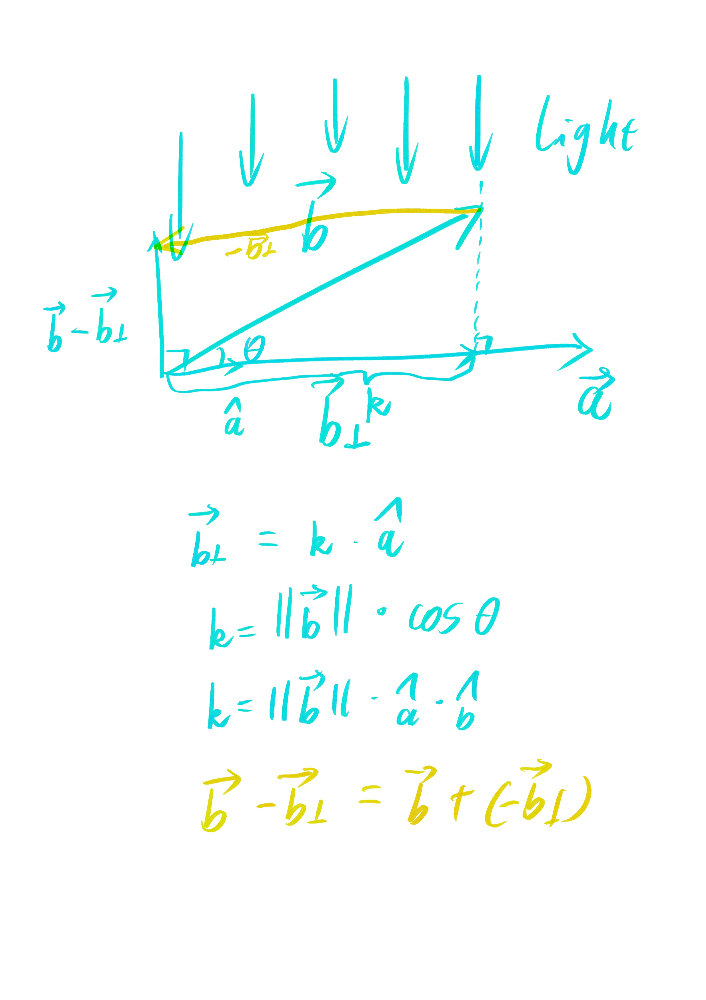

# Lecture 02

```math
\cos \theta = \hat a \cdot \hat b
```

向量点乘：交换、分配、结合

分量间相乘的积的和



向量叉乘：分配律、结合律

```math
展开法：\\
\vec a = (X_a,Y_a,Z_a)\\
\vec b = (X_b,Y_b,Z_B)\\
\vec a \times \vec b = \begin{bmatrix}
\hat i & \hat j & \hat k\\
X_a & Y_a & Z_a\\
X_b & Y_b & Z_b
\end{bmatrix}=
\hat i \begin{bmatrix}Y_a&Z_a\\Y_b&Z_b\end{bmatrix}
-
\hat j \begin{bmatrix}X_a&Z_a\\X_b&Z_b\end{bmatrix}
+
\hat k \begin{bmatrix}X_a&Y_a\\X_b&Y_b\end{bmatrix}

```
